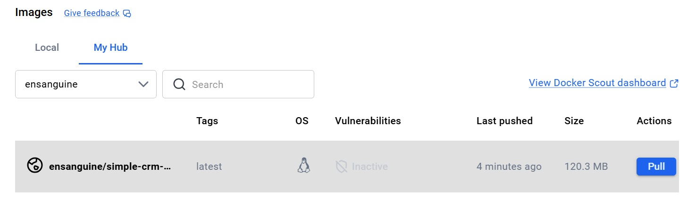
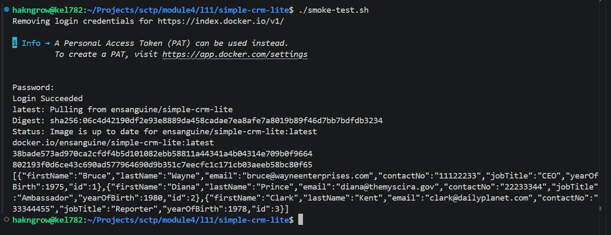
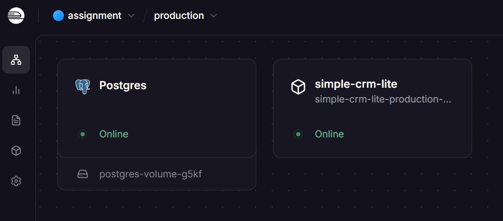

Completed Simple CRM Lite for [Lesson 4.11: CI Practicals - Applying CI to Simple-CRM-Lite](https://github.com/su-ntu-sctp/ai-4.11-ci-practicals/blob/main/lesson.md)

## Part 4 - Setup and Run Pipeline

## Part 5 Step 1: Verify Docker Image on Docker Hub

## Part 5 Step 2: Pull and Run the Image Locally

## Part 6 - Challenge: Deploy simple-crm-lite to Railway

Postgres database and `simple-crm-lite` image deployed on Railway.

Tested `customers` endpoint of `simple-crm-lite` app on browser

